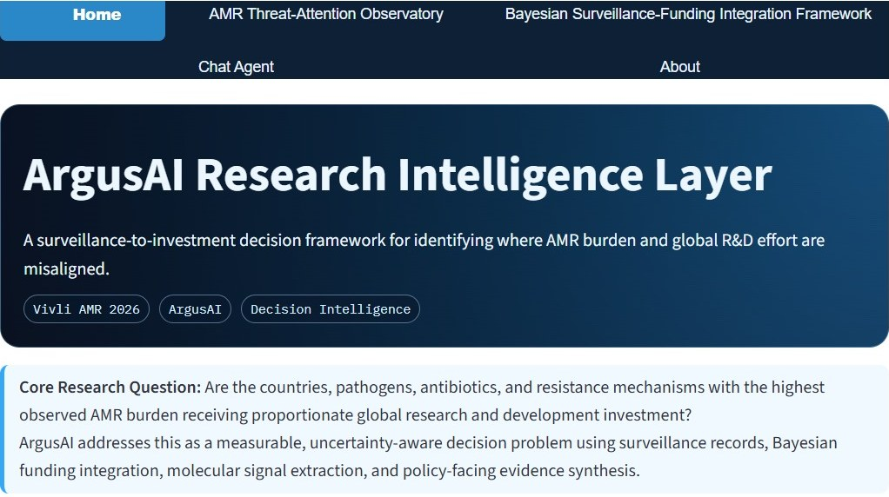

```{=html}
<div class="gs">

<section class="hero">
  <div class="hero-copy">
    <p class="eyebrow">Computational biology · Antimicrobial resistance</p>
    <h1 class="hero-name">Godswill Imolele Anthony</h1>
    <p class="hero-lede">I build Bayesian, uncertainty-aware AI for antimicrobial resistance and drug discovery: models that say not only <em>what</em> they predict, but <em>how far</em> to trust it.</p>
    <div class="btns">
      <a class="btn-gs primary" href="research.html">Explore my research</a>
      <a class="btn-gs" href="publications.html">Publications</a>
      <a class="btn-gs ghost" href="files/Godswill_Imolele_Anthony_CV.pdf">Download CV</a>
    </div>
    <p class="hero-sub">Team lead, Argus AI · Global AMR R&amp;D Hub Cross-Domain Award, 2026 Vivli AMR Surveillance Data Challenge</p>
  </div>
  <div class="hero-art">
    <svg class="curves" viewBox="0 0 400 300" preserveAspectRatio="xMidYMid slice" aria-hidden="true">
      <path d="M10 280 C70 280 100 90 160 90 C220 90 250 280 310 280 Z" fill="#7ce7d6" fill-opacity=".14" stroke="#7ce7d6" stroke-opacity=".7"/>
      <path d="M90 280 C150 280 190 40 250 40 C310 40 340 280 395 280 Z" fill="#fbbf24" fill-opacity=".12" stroke="#fbbf24" stroke-opacity=".6"/>
      <path d="M40 280 C110 280 140 150 200 150 C260 150 290 280 360 280 Z" fill="#fff" fill-opacity=".08" stroke="#fff" stroke-opacity=".35"/>
    </svg>
    
  </div>
</section>

<div class="stats">
  <div class="stat"><b>4.95M</b><span>isolate–drug observations in one Bayesian synthesis</span></div>
  <div class="stat"><b>71</b><span>countries, 44 species, ten antibiotics (2004–2024)</span></div>
  <div class="stat"><b>2</b><span>Vivli AMR placements: finalist, then Cross-Domain Award</span></div>
  <div class="stat"><b>2</b><span>first-author papers in machine-learning drug discovery</span></div>
</div>

<div class="quote">
  Every antibiotic is a conversation with four billion years of evolution.
  <small>I build models that know the limits of what they know, so that when we act, we act with open eyes.</small>
</div>

<section class="sec" id="research">
  <h2 class="sec-title">What I research</h2>
  <p class="sec-lede">Trustworthy inference when data are uneven, incomplete and in disagreement.</p>
  <div class="grid">
    <div class="card"><h3>Evidence synthesis under heterogeneity</h3><p>Hierarchical Bayesian models that combine surveillance data from different labs, methods and years without pretending they are the same.</p><span class="tag">Argus AI · ResistAI+</span></div>
    <div class="card"><h3>Disagreement as a signal</h3><p>When genotype and phenotype disagree, I keep both sources and make the discordance visible and reviewable.</p><span class="tag">NaijaResist · AGARI</span></div>
    <div class="card"><h3>Trustworthy discovery</h3><p>Scaffold-aware, honestly evaluated machine learning that tests predictions on new chemistry, not near-copies.</p><span class="tag">InhA · GRK5 · Morph-HSV</span></div>
    <div class="card"><h3>Molecular signal to outcome</h3><p>Multi-omics survival models linking immune biology to clinical outcome, including low HLA class I expression as a predictor of poorer survival.</p><span class="tag">Cox models · RNA-seq</span></div>
  </div>
  <p style="margin-top:1.2rem"><a class="btn-gs" href="research.html">Read the full research programme</a></p>
</section>

<section class="sec band" id="featured">
  <div class="feature">
    <div>
      <p class="eyebrow" style="color:var(--accent)">Featured project</p>
      <h2 class="sec-title">Argus AI: where the threat and the response fail to meet</h2>
      <span class="award">Global AMR R&amp;D Hub Cross-Domain Award · 2026 Vivli AMR Surveillance Data Challenge</span>
      <p class="sec-lede" style="margin-bottom:1rem">A Bayesian hierarchical synthesis of 4.95 million isolate–drug observations, linked with global AMR R&amp;D investment, to show where resistance burden, therapeutic vulnerability and funding are most dangerously misaligned, and how much that conclusion depends on how the data are weighted.</p>
      <div class="btns">
        <a class="btn-gs primary" href="https://argus-framework.streamlit.app/">Open live dashboard</a>
        <a class="btn-gs" href="https://amr.vivli.org/argus-ai-detecting-global-amr-innovation-burden-mismatch-with-bayesian-evidence-synthesis/">Official award entry</a>
      </div>
    </div>
    <a href="https://argus-framework.streamlit.app/"></a>
  </div>
</section>

<section class="sec" id="projects">
  <h2 class="sec-title">Systems you can open</h2>
  <p class="sec-lede">Each one makes its uncertainty visible. Dashboards run on free hosting, so an idle one may take about 30 seconds to wake.</p>
  <div class="grid">
    <div class="card"><span class="chip">Live</span><h3>Argus AI</h3><p>Threat–innovation gap observatory with sensitivity analyses and traceable evidence.</p>
      <a class="more" href="https://argus-framework.streamlit.app/">Open dashboard →</a>
      <a class="more" href="https://github.com/SirImoleleAnthony/ARGUS-AI-A-BAYESIAN-AMR-SURVEILLANCE-FUNDING-INTELLIGENCE-FRAMEWORK">Code →</a></div>
    <div class="card"><span class="chip">Live</span><h3>ResistAI+</h3><p>Change-points, MIC creep and posterior-predictive forecasts. Finalist, top 10% of 100+ teams.</p>
      <a class="more" href="https://resistaiplus.streamlit.app/">Open dashboard →</a>
      <a class="more" href="https://github.com/SirImoleleAnthony/Building-ResistAI-on-Atlas-Dataset-With-Bayesian-Hierarchical-Modeling-and-Causal-models-DAGs-">Code →</a></div>
    <div class="card"><span class="chip">Live</span><h3>NaijaResist</h3><p>Machine-learning resistance prediction for Nigeria with genotype–phenotype reconciliation.</p>
      <a class="more" href="https://naijaresist.streamlit.app/">Open dashboard →</a>
      <a class="more" href="https://github.com/SirImoleleAnthony/NIGERRESIST">Code →</a></div>
    <div class="card"><span class="chip warm">Competition</span><h3>Morph-HSV</h3><p>Resistance-aware ranking of 100 candidate inhibitors of HSV-1 DNA polymerase. Preliminary round submitted.</p>
      <a class="more" href="https://github.com/SirImoleleAnthony/MORPH_HSV-FOR-SHANGHAI-INT-L-COMPUTATIONAL-BIOLOGY">View code →</a></div>
  </div>
</section>

<section class="sec band" id="publications">
  <h2 class="sec-title">Selected publications</h2>
  <p class="sec-lede">Machine-learning-guided discovery and structural bioinformatics.</p>
  <a class="pub" href="https://doi.org/10.1093/biomethods/bpag015"><b>Discovery of novel InhA inhibitors through structural bioinformatics and machine learning-driven QSAR screening of natural products</b><span>Biology Methods and Protocols · 2026 · First and corresponding author</span></a>
  <a class="pub" href="https://doi.org/10.1186/s43042-025-00780-x"><b>In silico evaluation of 4-quinolone ligands interacting with GRK5 using message-passing neural networks, docking and molecular dynamics</b><span>Egyptian Journal of Medical Human Genetics · 2025 · First author</span></a>
  <a class="pub" href="https://doi.org/10.1016/j.insi.2026.100182"><b>Integrative machine learning and structural bioinformatics for selective sterol 14α-demethylase inhibitors targeting Trypanosoma cruzi</b><span>In Silico Research in Biomedicine · 2026 · Contributing author</span></a>
  <p><a class="btn-gs" href="publications.html">All publications</a></p>
</section>

<section class="sec" id="outputs">
  <h2 class="sec-title">Beyond the papers</h2>
  <div class="grid">
    <div class="card"><h3>Awards and challenges</h3><p>Cross-Domain Award, 2026 Vivli Challenge · Winner, 2025 Advanced CADD Machine-Learning Drug Discovery Challenge · Finalist, 2025 Vivli Challenge · Oral Presentation Award, NextGen Africa Symposium</p></div>
    <div class="card"><h3>Teaching and mentoring</h3><p>Led research-skills workshops for about 81 participants (African Community for Systematic Review and Meta-Analysis). Supervise undergraduate students in reproducible bioinformatics.</p></div>
    <div class="card"><h3>Now</h3><p>Bioinformatics Associate at BioSeq (AGARI <em>E. coli</em> data integration with Africa CDC / ASLM). Project Lead at Helix Biogen Institute.</p></div>
    <div class="card"><h3>Toolbox</h3><div class="pills"><i>Python</i><i>R</i><i>SQL</i><i>Bayesian modelling</i><i>QSAR</i><i>Docking &amp; MD</i><i>DESeq2</i><i>Streamlit</i></div></div>
  </div>
</section>

<section class="sec band cta" id="contact">
  <h2 class="sec-title">Let’s talk</h2>
  <p class="sec-lede" style="margin:0 auto 1.4rem">Open to conversations about AMR surveillance, pathogen genomics, Bayesian methods, drug discovery, and PhD supervision.</p>
  <div class="btns">
    <a class="btn-gs primary" href="mailto:anthonyimolele@gmail.com">Email me</a>
    <a class="btn-gs" href="https://orcid.org/0000-0002-3093-3309">ORCID</a>
    <a class="btn-gs" href="https://scholar.google.com/citations?user=aedgJX4AAAAJ&hl=en">Google Scholar</a>
    <a class="btn-gs" href="https://github.com/SirImoleleAnthony">GitHub</a>
    <a class="btn-gs" href="https://www.linkedin.com/in/godswill-anthony-850639199">LinkedIn</a>
  </div>
</section>

<p class="foot">© 2026 Godswill Imolele Anthony · Port Harcourt, Nigeria</p>
</div>
```
